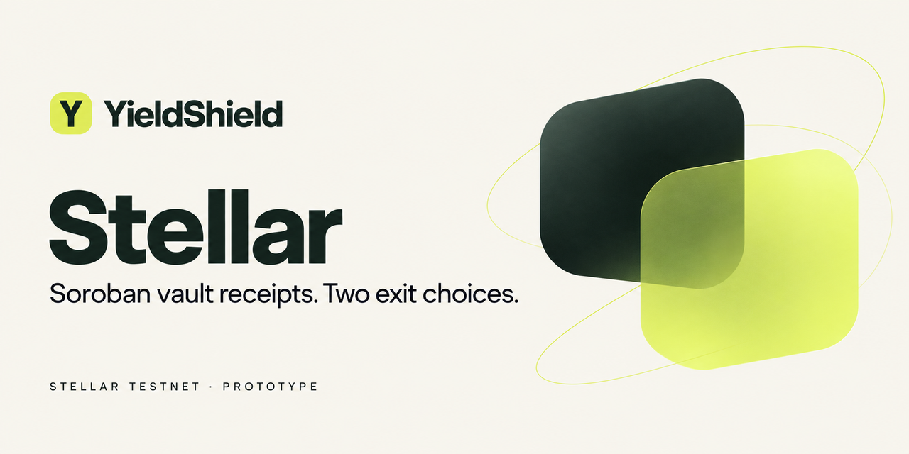

# YieldShield Stellar — Reserve Lab

Native Soroban markets that split vault risk explicitly. Holders protect funded vault receipts against a fixed, separately reserved backing claim; capital providers supply that first-loss backing and earn surrendered receipts and a share of realized gains. Every reserve, exit, fee and claim is enforced and visible onchain.

**Live demo:** https://stellar.yieldshield.ai (Stellar Testnet, valueless test assets). **License:** [MIT](LICENSE).

> Testnet only and unaudited. TESTUSD is issued for this demonstration; it is not Circle USDC and has no monetary value or redemption. XLM only pays network fees and account reserves. Do not use this code with real funds.

## Status — 13 October 2026

- **Deployed:** a fresh stack, deployed on 12 October 2026 with new keys, runs the current pool, factory, vault and exchange contracts. `verify-v3-deployment.mjs` read back 14 contract instances and 6 Wasm code entries matching their recorded hashes; all three featured pools accept providers until they mature on 11 November 2026, after which they are replaced.
- **End-to-end:** on 13 October a brand-new Friendbot-funded wallet completed 19 browser-signed transactions through the app (trustline, faucet, vault, exchange, provider, protection, transfer, exits, gain-fee and receipt claims, withdrawal), each independently read back as successful ([report](docs/E2E_REPORT.md#fresh-stack-run-13-october-2026)). The real Freighter extension's own screens are not exercised by that harness.
- **Tests:** 67 native contract tests, 82 JavaScript tests and the production build pass.
- **Archived:** the original stack (11 October 2026) stays on Testnet without renewal; its manifests and evidence are in [docs/evidence/archive-2026-10-12](docs/evidence/archive-2026-10-12/).

No partnership, award, audit, mainnet readiness or customer traction is claimed.

## How it works

| Role | What they do |
|---|---|
| Holder | Deposits TESTUSD into a funded vault for transferable receipts, then protects them. The pool fixes a backing claim at the exact vault redemption value and reserves 150% of it. After a 60-second delay the holder exits fully or partially: **receipt exit** (gains pay 10% to providers, 1% to the pool creator and 1% to the protocol) or **backing exit** (surrender receipts for the fixed claim). Positions can be transferred. |
| Provider | Deposits backing for pool shares while no holder position is open, requests withdrawal notice (30 seconds on featured pools) and withdraws once positions are closed. Gain-fee receipts and surrendered ("acquired") receipts are claimed separately. Provider capital can lose value. |
| Anyone | Settles positions after maturity: the holder receives a segregated backing credit, and the remaining receipts go to providers. Creates a community pool through the factory with bounded terms (300 seconds to 30 days) and a refundable 10 TESTUSD bond; at most 50 unmatured pools exist at once, 5 per creator. |

Funded exchanges trade receipts against their vault's backing from finite inventory with a 0.3% spread. A test faucet gives each wallet 1,000 TESTUSD once. The original single-sponsor pool remains available at `/legacy`.

| Asset | Backing | Notes |
|---|---|---|
| TESTUSD | Classic asset from the project issuer | Requires a trustline; accessed through its Stellar Asset Contract |
| ysALPHA, ysBETA | Funded TESTUSD vaults | Seven-decimal receipts; gains come from funded donations, not a live strategy |
| ysNEST | Vault of ysALPHA receipts | Its fixed claims are in ysALPHA units, not dollars |

Contract details: [pool and factory](contracts/pool-v3/README.md), [exchange](contracts/market/README.md), [legacy pool](contracts/README.md).

## Deployed contracts (Stellar Testnet)

| Contract | ID |
|---|---|
| Factory | [`CBE2M56H…TEO7QO`](https://stellar.expert/explorer/testnet/contract/CBE2M56HQHQJQERR4VXATMXKISQJTNGKAYMJNG56WUTHL5CWKJTEO7QO) |
| Reserve Alpha pool / vault / exchange | [`CD2XFXLG…FX3EQTE`](https://stellar.expert/explorer/testnet/contract/CD2XFXLGNZDNOBMJFGQTQ7QITADUTQSNXRDNUBU5P5F4IGZA2FX3EQTE) / [`CCYNKJNH…FCPEEOXM`](https://stellar.expert/explorer/testnet/contract/CCYNKJNHCPHOVGNQZYIFYH4S5YKSKE3S44Z5TQTZICHJ35YRFCPEEOXM) / [`CAAGQEPU…TSZ6JBLXL`](https://stellar.expert/explorer/testnet/contract/CAAGQEPURTU77DRAJZR3QV4IIMHELI4WISGN6T6TCPMQBICTSZ6JBLXL) |
| Reserve Beta pool / vault / exchange | [`CDKP2F3P…XZ3JZ7M`](https://stellar.expert/explorer/testnet/contract/CDKP2F3P3HQYXF5WPJYGTFBPLNQFPZW76L76Q5IHJYUIRKD72XZ3JZ7M) / [`CAVL6VYI…6FCB64ZMRJ`](https://stellar.expert/explorer/testnet/contract/CAVL6VYIKDZH5NIQ5F535JJNJEGP6VSOCXJN77USOOUPQI6FCB64ZMRJ) / [`CCEGCYUE…3A4CWFT`](https://stellar.expert/explorer/testnet/contract/CCEGCYUEIKA2YO7XMIKEXJUWUEQDQ3AWBK6H35GQCG43OHRO53A4CWFT) |
| Receipt Reserve pool / vault / exchange | [`CD6G5G5C…ROEAOLSF`](https://stellar.expert/explorer/testnet/contract/CD6G5G5CQ4LTFOWUNW2GXFA47BEGBYE4BCU2XHHTOFX3XTXXROEAOLSF) / [`CDUA6ZRQ…47GVGHDQ`](https://stellar.expert/explorer/testnet/contract/CDUA6ZRQ5B4WKFSPUHQZTQUW6LOQQ5CWTR4EAYLGKGND6GSA47GVGHDQ) / [`CDR3CM6J…L2XGBQ`](https://stellar.expert/explorer/testnet/contract/CDR3CM6JTF6GXUNW6BEYAPAMIIMN4VVUFSXKFGK7JY2YQKQG46L2XGBQ) |
| TESTUSD asset contract / issuer | [`CCL3I7LL…6ZSYZ4`](https://stellar.expert/explorer/testnet/contract/CCL3I7LLPPTQE6RKBN4NHKX77HSGHL7YULVTAX3IBFXOKPNNKR6ZSYZ4) / [`GBSIZTW6…NJI7AS`](https://stellar.expert/explorer/testnet/account/GBSIZTW6UJ2DYDNYDIXHMR4ROHQEPGWK6Y2CJW3E3KEPPQMDVLNJI7AS) |
| Faucet | [`CDX2KQBR…JIC7BFR`](https://stellar.expert/explorer/testnet/contract/CDX2KQBR2XJLLAXF5BYJ2V4YN2WOJGXT4IP2OF37MQLS6HLZYJIC7BFR) |
| Legacy pool / vault | [`CBJV5RWC…BUKFS4C`](https://stellar.expert/explorer/testnet/contract/CBJV5RWC5775GSSXX66LQDWOJMW7VP56N4CLNUHMHBMTW6SNYBUKFS4C) / [`CA26ORGY…MFB3Y5JJ`](https://stellar.expert/explorer/testnet/contract/CA26ORGYTS4PFXRNCL5M63WWL6CPGRYK6A57JHQPPF6BF44IMFB3Y5JJ) |

The full identities and Wasm hashes are in [config/markets.json](config/markets.json) and [config/testnet.json](config/testnet.json); the website reads exactly these files.

## Run and verify

Requirements: Node.js 24+, Rust 1.99 with the `wasm32v1-none` target, and Stellar CLI 28.1.0 (install commands in [operations](docs/OPERATIONS.md)).

```sh
npm ci --ignore-scripts
npm test                      # JavaScript tests
npm run build                 # static website in dist/
npm run dev                   # development server reading the live Testnet contracts
sh scripts/check-native.sh    # builds the Wasm and runs the native contract tests
```

Factory tests deploy the built pool Wasm, so build it (`stellar contract build`) before `cargo test --workspace` on a clean checkout; `scripts/check-native.sh` does both in order.

Read-only checks against the live deployment need no keys:

```sh
node scripts/check-deployment.mjs        # faucet, legacy vault and pool, TESTUSD
node scripts/verify-v3-deployment.mjs    # instances, Wasm hashes, solvency, provider entry
node scripts/extend-testnet.mjs          # storage lifetimes; --broadcast renews what is due
```

Deploying your own stack (`deploy-testnet.mjs` and `deploy-v3.mjs` with `--broadcast`) uses disposable identities in the ignored `.secrets/stellar` directory; see [operations](docs/OPERATIONS.md). Never use keys that hold real funds, and never copy signer files into a website deployment.

Further reading: [architecture and policy decisions](docs/ARCHITECTURE.md), [token integration and future Blend wrapper](docs/TOKEN_INTEGRATION.md), [end-to-end evidence](docs/E2E_REPORT.md), [hosting releases](docs/HOSTING.md), [release evidence](docs/RELEASE.md) and the [build ledger](docs/BUILD_LEDGER.md).

## Contributing and security

Issues and pull requests are welcome. Please run `npm test`, `npm run build` and `sh scripts/check-native.sh` before proposing changes. Report suspected vulnerabilities privately as described in [SECURITY.md](SECURITY.md), not in public issues.

## License

[MIT](LICENSE), copyright Hawig Ventures UG (haftungsbeschränkt), which develops YieldShield. Dependencies such as the Stellar SDK, soroban-sdk, Freighter API and React retain their own licenses.

This is a new native implementation informed by YieldShield's earlier EVM product behavior; it does not copy Solidity, signers, private environment files or vendor source. Code and documentation were written with substantial AI assistance and need independent review before handling real assets.
